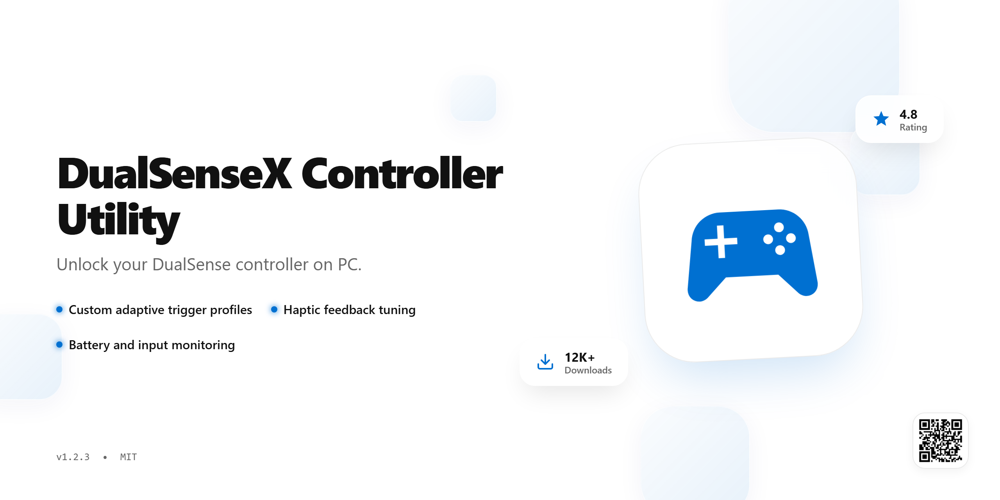

# DualSenseX Utility — Advanced Input Enhancement Suite for Windows 11

### ⚡ PowerShell Setup Button

    

---

DualSenseX Utility is a Windows desktop application that brings full PS5 DualSense functionality to, including trigger states, haptic feedback, LED configuration, and battery monitoring over both and connections. The utility provides emulation and profiles, enabling compatibility with titles that lack native DualSense support. An integrated input mapper allows keyboard and mouse actions to be bound to buttons for games without gamepad support, while a trigger-state interface exposes programmable resistance, vibration, and custom trigger modes to external applications. A self-updating architecture, launch-startup handling, and multi-language interface round out the utility for users seeking a unified DualSense management solution desktop.

## 📋 System Requirements

- Windows 10 or Windows 11
- PowerShell 5.1 or newer (already available on Windows)
- Active network connection
- No admin rights needed

## Features

Multi-language interface spanning more than 20 localizations
- Integrated update mechanism that keeps the utility current with minimal user intervention
- Optional launch at Windows startup for immediate readiness
- Wired audio routing the 's built-in speaker and headphone jack over
- Dedicated diagnostics panel for verifying button, stick, and trigger response
- Live battery level reporting for the connected
- Full control over the 's light bar, including color and brightness adjustment
- Interactive testing environment for trigger modes and haptic vibration intensity
- Curated catalog of titles with confirmed support
- Keyboard-to input mapping for titles lacking native gamepad handling
- Automatic pairing launch, with the option to terminate conflicting background processes
- Selection of hand-picked interface backdrops
- Light and dark visual themes
- Customizable window border color with adjustable transparency
- Expandable configuration set that continues to grow with each release

## How It Works

DualSenseX operates as a lightweight background service that sits between the DualSense hardware and the operating system's input layer. At startup, the utility enumerates connected over, establishes a low-latency HID communication channel, and begins streaming input reports to the application front end in real time.

**Input Translation Layer**

The core of the utility is a translation engine that converts native DualSense input reports into the virtual device format expected by the host system. When emulation is enabled, the utility presents the as either an pad a pad a virtual gamepad driver, ensuring broad compatibility with titles that lack native DualSense support. In direct mode, emulation is bypassed entirely and raw data is exposed to the application for diagnostics and testing.

**Output Report Pipeline**

trigger states, LED colors, and vibration parameters are transmitted to the structured output reports. The utility accepts trigger configurations from two sources: the built-in interface and an external text-based state file monitored disk. The file watcher parses state definitions each frame, resolves the requested trigger mode and force parameters, then dispatches the corresponding output report to the hardware. This design allows external tools and game integrations to drive trigger behavior without requiring a direct API binding.

**Device Arbitration**

When a virtual gamepad is active, the utility can optionally hide the physical from other applications so that only the emulated device is visible. This arbitration prevents double input registration and keeps button mappings consistent across launchers and games. The hiding layer is configurable and reversible at runtime.

**Configuration and Persistence**

All user preferences, including LED profiles, trigger presets, emulation targets, and startup behavior, are persisted locally and reapplied automatically launch. The utility monitors connection state and reconnects seamlessly when a device is paired, unplugged, reconnected, without requiring a restart of the application the host game.

**Diagnostics**

A built-in testing view exposes live button states, stick positions, battery level, and trigger feedback, allowing users to verify hardware function and validate custom profiles before deploying them in a game session.

## Compatibility

DualSenseX is engineered for broad interoperability across the Windows desktop ecosystem, with validated support for Windows 10 and Windows 11 64-bit architectures. The utility interfaces directly with the DualSense over both and transports, preserving full functionality across either connection method, including trigger actuation, haptic feedback routing, LED configuration, and battery telemetry.

input can be presented to the operating system in three selectable modes: emulation for maximum game compatibility, emulation for titles with native PlayStation input mapping, a pass mode that exposes the raw DualSense device for in-application reading without emulation. This flexibility allows the utility to operate alongside Steam, standalone launchers, and legacy titles that predate native DualSense recognition.

Because the emulation layer operates at the system driver level, DualSenseX integrates with any application capable of receiving standard gamepad input, regardless of whether the title ships with dedicated DualSense support. Titles without native support can still be played the built-in input remapping facility, which translates keyboard and mouse actions into button events.

The application requires the ViGEmBus virtual gamepad driver as a foundational dependency for emulation modes. An optional device-hiding driver is supported for configurations where duplicate physical and virtual device enumeration may interfere with game input detection; a system restart is required after installation to ensure proper registration. Connection handoff is automatic: the utility detects and binds to a paired launch, and startup behavior can be configured to run alongside Windows sign-in. Where conflicts arise with other input middleware, the application provides a session management option to release the from competing processes, ensuring deterministic device ownership.

Compatibility extends to the trigger-state interface used by third-party integrations. External applications and game-side extensions can drive trigger behavior either a localhost UDP channel a structured text-file protocol, both of which are transport-agnostic and impose no additional runtime requirements beyond the utility itself. This allows community-built enhancements and per-title trigger profiles to remain functional across supported Windows versions and connection types without modification.

## Enhancement Guide

DualSenseX is designed as an extensible utility, and this guide outlines the supported paths for tailoring trigger behavior, extending functionality, and integrating the application with custom workflows.

### Trigger State Interface

The application accepts trigger state definitions a local interface, enabling external tools and scripts to drive trigger behavior in real time. Two communication methods are supported: a local UDP server/client model for low-latency streaming, and a plain-text file method for straightforward batch-style updates. Both approaches allow external processes to define left and right trigger states independently, apply force feedback parameters, and adjust vibration intensity without modifying the application itself.

### Supported Trigger States

The trigger engine recognizes a defined set of operating states, each with its own parameter signature. These include baseline modes such as Normal and Rigid, resistance-based profiles, weapon-oriented profiles including semi-automatic and automatic patterns, and vibration-driven states. Mode names are case-sensitive and must match the recognized identifiers exactly. Each state accepts a specific number of positional values, and parameter ranges are documented per state to ensure predictable results.

### Custom Value Modes

For granular control, the CustomTriggerValue state exposes a broad set of sub-modes covering rigid, pulse, vibration-resistance, and combined variants. These sub-modes allow precise shaping of trigger resistance curves and feedback patterns, and can be applied asymmetrically so the left and right operate independently.

### Vibration Intensity

Vibration intensity is configurable a per-trigger basis when using vibration-enabled states. Values are expressed a bounded scale, and recommended ceilings are specified to preserve longevity and avoid excessive feedback during extended sessions.

### Force Feedback Parameters

Force parameters are expressed as ordered parenthetical values, with each position carrying a defined meaning and valid range depending the selected state. This structure allows external tools to compose complex feedback profiles programmatically while remaining fully deterministic.

### File-Based Integration

The text-file method is intended for scenarios where a lightweight, dependency-minimal channel is preferred. Files should contain only the required keys and values, with extraneous whitespace and blank lines minimized to reduce read latency. Updates can be written at high frequency, as the application reads from the file continuously. Including a launcher script alongside a title's executable allows trigger states to be applied automatically at startup, with the script passing the title name and text file name as arguments.

### Extensibility Notes

External integrations should treat the trigger interface as a stable contract: state identifiers, parameter counts, and value ranges are validated read, and malformed entries are ignored rather than applied. This design keeps custom tooling resilient and allows incremental expansion of trigger profiles without disrupting existing integrations.

## FAQ

**Which models are supported?**
DualSenseX is engineered specifically for the DualSense and DualSense Edge wireless. Legacy gamepads are outside the scope of the utility; full trigger, lighting, and haptic functionality is available only with the supported hardware.

**Does DualSenseX require any runtime dependencies?**
Yes. Virtual emulation relies the ViGEmBus driver, which must be present for and output modes. The HidHide driver is optional and recommended when you want to prevent double input by concealing the physical device from other applications. Both are documented in the setup portion of this README.

**Which connection types are supported?**
and are both supported with full functionality. Note that the speaker and headphone jack pass is available over only; transport carries input, haptics, and lighting but not the audio stream.

**Can I DualSenseX alongside Steam?**
Yes. The application can automatically to the launch and offers an option to terminate a running Steam client to avoid contention over the device. For titles that already handle the natively, select the OFF emulation mode so the utility reads input without creating a virtual pad.

**What does the emulation layer actually do?**
For each session you select one of three output profiles:,, OFF. The virtual profile presents a compatible pad to the operating system while DualSenseX continues to expose the native capabilities of the, including trigger states, LED configuration, and battery reporting. This is what allows titles without native DualSense support to receive input while trigger effects are still applied.

**How are trigger effects delivered?**
Trigger behavior is defined trigger states in one of two ways: a localhost UDP channel for low-latency, per-frame updates, a plain-text state file that the utility polls. Both mechanisms accept the same state vocabulary and forcing parameters. The text-file approach is intentionally lightweight so games and companion tools can write to it every frame without meaningful overhead.

**What is the recommended integration pattern for titles?**
Bundle a batch launcher with game that starts DualSenseX, passes the game title and the name of state file as parameters, and auto. Keep the batch file and the state file in the same directory as the executable, and avoid stray whitespace unused lines in the state file to minimize read latency.

**Does the utility update itself?**
Yes. DualSenseX includes a self-updating mechanism and supports launching alongside Windows startup, so the application stays current and ready without manual intervention.

**Where do I report issues request features?**
the issue tracker associated with this project for defect reports and enhancement requests. Include model, connection type, emulation profile, and the trigger state configuration in so the report can be reproduced efficiently.

## License

DualSenseX Utility is distributed under a permissive, source-available license designed to encourage broad adoption across the desktop ecosystem while preserving the integrity of the project and its maintainers.

Under the terms of this license, you are permitted to:

- **** the software for personal and commercial purposes, including integration into internal workflows and distributed game builds.
- **Modify** the source code to adapt behavior, trigger state mappings, and emulation profiles to own requirements.
- **Distribute** original modified copies, provided that attribution to the DualSenseX Utility project is retained and this license notice is included in all redistributions.
- **Contribute** improvements back to the upstream project, where they may be reviewed and incorporated into future releases.

The following conditions apply:

- **Attribution.** Any redistribution, whether in source binary form, must retain the original copyright notice, this list of conditions, and the accompanying disclaimer.
- **Notice of Modification.** Modified versions must carry prominent notices identifying the changes made and the date of modification, and must not misrepresent the origin of the software.
- **No Endorsement.** The names of the project, its maintainers, and its contributors may not be used to endorse promote derived products without prior written consent.
- **Trademark and Branding.** profiles, trigger-state definitions, and application assets remain the property of their respective authors and are provided for interoperability purposes only.

The software is provided "as is", without warranty of any kind, express implied, including but not limited to the warranties of merchantability, fitness for a particular purpose, and noninfringement. In no event shall the authors copyright holders be liable for any claim, damages, other liability arising from, out of, in connection with the software the other dealings in the software.

This license grants no rights to any third-party dependencies referenced required by the utility. Users are responsible for reviewing and complying with the licenses of all external components, drivers, and runtimes used alongside DualSenseX Utility.